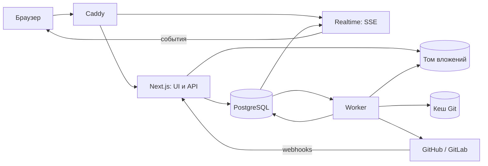

# ADR-0001. Архитектура PushDocs

PushDocs разрабатывается как CMS для существующих проектов Docusaurus с установкой на собственном сервере. Предлагается модульный монолит на Next.js с отдельными процессами фоновых задач и доставки событий. Git хранит закоммиченные документы, а PostgreSQL хранит черновики, доступы, обсуждения и состояние операций.

Документ определяет архитектуру первой полноценной версии. Решение принято 7 сентября 2026 года. В репозитории реализован рабочий MVP, а отличия от полной версии перечислены ниже.

Уточнение от 10 сентября 2026 года: актуальный [план доработки](../development-plan.md) предусматривает конфигурацию особенностей репозитория без отдельного адаптера sendsay-docs. Полный сайт собирает существующий CI документации после отправки изменений. PushDocs связывает его с текущим SHA через проверку `preview:deploy` и формирует URL по номеру PR/MR. Встроенный runner из [ADR-0002](0002-isolated-draft-preview.md) больше не используется.

## Связанные документы

Все решения перечислены в [указателе ADR](index.md). Подробности отдельных подсистем:

| ADR | Область |
| --- | --- |
| [0006. Git, ветки и проверка изменений](0006-git-workflow.md) | Черновики, отправка коммитов, конфликты, адаптеры GitHub/GitLab и проверки PR/MR |
| [0007. Контент Docusaurus и редактор](0007-content-editing.md) | Импорт, Markdown/MDX, компоненты, вложения, обсуждения и интерфейс |
| [0008. Проекты, пользователи и доступ](0008-project-access.md) | Изоляция проектов, подключения, членство, роли, приглашения и сессии |
| [0009. Realtime и доставка событий](0009-realtime-events.md) | SSE, журнал событий, курсоры, переподключение и отзыв доступа |
| [0010. Установка, эксплуатация и восстановление](0010-deployment-and-recovery.md) | Compose, миграции, секреты, резервные копии и наблюдаемость |

Исходный порядок разработки и критерии приёмки сохранены в [первоначальном плане](../initial-implementation-plan.md); текущие этапы и статус реализации — в [плане доработки](../development-plan.md).

## Состояние реализации

MVP поддерживает несколько проектов, GitHub и GitLab, включая GitLab Self-Managed. Реализованы импорт веток, черновики Markdown и MDX, создание документов, загрузка вложений, внутренние комментарии, роли, приглашения и обновления через SSE. Worker отправляет набор файлов одним коммитом с проверкой SHA ветки, создаёт PR или MR, получает проверки и переводит изменившиеся файлы в интерфейс разрешения конфликтов.

В MVP слияние выполняется в интерфейсе провайдера. Комментарии GitHub и GitLab пока не синхронизируются с внутренними комментариями, а состояния PR и MR обновляются опросом раз в 30 секунд без webhook. Предпросмотр не исполняет компоненты подключённого репозитория и показывает для них безопасные блоки. Эти ограничения сохраняют границы доверия, но требуют следующих этапов разработки перед production-релизом.

## Контекст и требования

Продуктовый ориентир, [Dhub](https://dhub.dev/), предлагает визуальное редактирование Markdown/MDX и работу с GitHub. PushDocs должен предоставлять похожий редактор для Docusaurus, поддерживать GitLab и работать на инфраструктуре владельца.

| Требование | Решение первой версии |
| --- | --- |
| Установка на собственном сервере | Docker Compose, PostgreSQL, постоянные тома, первый запуск и обновление без обязательных облачных сервисов |
| Несколько проектов в одной установке | Общие сервисы установки, отдельные профили, ветки, черновики, подключения и операции каждого проекта |
| Несколько веток одновременно | Независимые наборы изменений и состояние редактора для каждой ветки, включая несколько вкладок браузера |
| GitHub и GitLab | GitHub.com, GitLab.com и несколько экземпляров GitLab Self-Managed с собственными адресами и сертификатами |
| Конфликты в интерфейсе | Сравнение трёх версий текста, ручной итог, выбор файла для бинарных конфликтов, проверка актуальности решения |
| Пользовательские компоненты | Каталог компонентов, формы свойств, вложенное содержимое и сохранение неподдерживаемого MDX через исходник |
| Проверки PR/MR | Статусы, вывод и аннотации в доступном API объёме, связь с ревизией, ссылки на полный результат |
| Комментарии | Обсуждения внутри CMS, чтение и явная отправка комментариев в PR/MR |
| Обновления в реальном времени | Статусы, обсуждения, изменения веток и прав доступа через SSE |
| Файлы и изображения | Загрузка, предпросмотр, вставка ссылок и отправка вместе с документом одним коммитом |
| Несколько пользователей | Приглашения и три фиксированные роли с проверкой прав на сервере |
| Стек | Yarn, Next.js, TypeScript, PostgreSQL, Docker Compose, Base UI |

Пользователь подтвердил, что одновременное посимвольное редактирование и общие курсоры не требуются. Также подтверждены роли «Администратор», «Редактор» и «Читатель», причём читатель может оставлять комментарии.

Термины «ветка», «версия документации», «набор изменений» и «запрос на слияние» имеют разные значения. Определения находятся в [словаре проекта](../../CONTEXT.md).

## Связь с предыдущими проектами

Решения основаны на просмотре инструкций, зависимостей, конфигурации развёртывания и выбранных модулей Selflify, selfchecks и appnotes на 7 сентября 2026 года. В таблице отделены уже применённые подходы от предлагаемых изменений.

| Проект и изученные файлы | Используемый подход | Применение в PushDocs |
| --- | --- | --- |
| Selflify: `AGENTS.md`, `package.json`, `src/lib/operations.ts` | Next.js App Router, Yarn 4, типизированные сервисы, проверка ревизии перед изменением, журнал результата операции | Тонкие HTTP-обработчики, `expectedRevision`, отдельное состояние долгих операций и восстановление после сбоя |
| Selflify: `README.md`, `AGENTS.md` | Первый запуск, Caddy, отдельные dev/prod Compose, проверка установки | Аналогичный путь установки, безопасный bootstrap и smoke-тест полного стека |
| selfchecks: `package.json`, `apps/web/package.json`, `packages/db/package.json` | Yarn workspaces, Next.js, отдельные web/worker, PostgreSQL и миграции | Монорепозиторий и worker для Git, интеграций и обработки вложений |
| selfchecks: `README.md` | Установка через bootstrap-архив, PostgreSQL, Redis и Caddy | Повторяемый bootstrap; потребность в Redis оценивается отдельно |
| appnotes: `docs/runtime-architecture.md`, `apps/api/src/database/domain-events.ts`, `apps/realtime/src/event-source.ts` | Разделение domain/core/contracts, транзакционные события, уведомление клиентов и повторное чтение данных | Явные границы модулей, журнал событий PostgreSQL и realtime без пересылки полного содержимого документов |
| appnotes: `deploy/selfhost/compose.yml`, `packages/ui/src/components/button.tsx`, `.yarnrc.yml` | Один внешний origin, разные процессы и права БД, общий UI-пакет, Yarn с `node-modules` | Один адрес CMS, отдельный realtime, централизованные UI-компоненты поверх Base UI |

PushDocs использует PostgreSQL вместо JSON-конфига Selflify, поскольку черновики и комментарии требуют транзакций. Для первой версии достаточно очереди в PostgreSQL, поэтому Redis/BullMQ из selfchecks не переносится. API размещается в Next.js, а отдельный NestJS-сервис из appnotes пока не требуется. SSE заменяет WebSocket, поскольку обновления идут от сервера к клиенту.

Из старых проектов переносим архитектурные приёмы. Их Chakra UI и Radix-компоненты заменяются собственным набором на Base UI согласно выбранному стеку.

## Границы первой версии

Одна установка обслуживает несколько проектов с общими учётными записями пользователей и подключениями к Git-провайдерам. Доступ и роли назначаются отдельно в каждом проекте. Проект указывает на один сайт Docusaurus и его корень в репозитории. Несколько сайтов монорепозитория подключаются как отдельные проекты.

Согласована структура `Установка → Проекты → Ветки → Документы`. Рабочие области не вводятся: независимые организации в одной установке не требуются, а разные составы пользователей поддерживаются доступом на уровне проекта.

Поддержка нескольких проектов обязательна уже в первой версии. Один Compose-стек обслуживает одновременно, например, sendsay-docs в собственном GitLab и другой сайт документации в GitHub. Для каждого проекта не требуется отдельная установка, база данных или домен CMS.

Редактор работает с документами, front matter, изображениями и объявленными компонентами. В рамках проекта поддерживаются несколько наборов docs, языков и версий Docusaurus. Корни содержимого задаются явно, если автоматическое определение неоднозначно. Проект `sendsay-docs` является обязательным контрольным примером совместимости; особенности зафиксированы в [анализе импорта](../compatibility/sendsay-docs.md).

Полная версия включает оба Git-провайдера, разрешение конфликтов, вложения, комментарии и realtime. Этапы [первоначального плана](../initial-implementation-plan.md) определяют порядок реализации, а не перенос обязательных возможностей на неопределённое будущее.

В первую версию не входят синхронное редактирование текста, автономная работа без сети, конструктор произвольных ролей, собственный CI и хостинг опубликованного сайта. Создание React-компонентов остаётся задачей разработчиков репозитория. GitHub Enterprise Server, Git LFS и редактирование submodule рассматриваются отдельно.

## Структура приложения и стек

Выбирается Yarn 4 с зафиксированной версией `packageManager`, `yarn.lock` и `nodeLinker: node-modules`, как в предыдущих проектах. Установка в CI использует `yarn install --immutable`. Базовые линии, Next.js 16 и React 19, уже используются в appnotes; конкретные поддерживаемые исправленные версии фиксируются при bootstrap. Node.js выбирается из поддерживаемой LTS-линии, совместимой с зависимостями. Версии относятся к самой CMS. Импортируемый сайт сохраняет свой Yarn, React, Docusaurus и lockfile; переход sendsay-docs с Yarn 1 и React 18 для импорта не требуется.

PostgreSQL 17 принимается начальной основной версией по аналогии с self-hosted appnotes. Для доступа выбираются Kysely и `pg`, а изменения схемы выполняются версионированными миграциями. SQL нужен для условных обновлений, блокировок и очереди задач. Kysely уже используется в appnotes и позволяет держать такие запросы явными.

Base UI (`@base-ui/react`) предоставляет интерактивные примитивы. Собственные стили, CSS-переменные и Tailwind формируют внешний вид в `packages/ui`. Base UI не задаёт визуальный стиль приложения. См. [официальное руководство Base UI](https://base-ui.com/react/overview/quick-start).

```text
apps/
  web/                 Next.js App Router, страницы и HTTP API
  worker/              Git, провайдеры, вложения, фоновые задачи
  realtime/            SSE, подписки, проверка доступа, доставка событий
packages/
  domain/              Правила ролей, веток, публикации и конфликтов
  core/                Прикладные сценарии и интерфейсы внешних зависимостей
  contracts/           Схемы запросов, ответов, ошибок и событий
  db/                  Kysely, миграции, хранилища и очередь PostgreSQL
  providers/           Адаптеры API GitHub и GitLab, чтение и условная запись
  content/             Docusaurus, Markdown/MDX и конфигурация компонентов
  ui/                  Base UI, стили и общие элементы интерфейса
deploy/                Конфигурация Caddy
Dockerfile             Сборка web, worker и realtime
compose.yml            PostgreSQL, миграции и процессы приложения
docs/adr/              Архитектурные решения
```

`domain` не зависит от React, Next.js, SQL или Git SDK. `core` использует `domain`, контракты и узкие интерфейсы хранилищ, Git и провайдеров. Адаптеры реализуют интерфейсы, а приложения связывают зависимости. HTTP-обработчики проверяют ввод и вызывают прикладной сценарий, но не содержат алгоритмы слияния.

Server Components используются для оболочки и первоначальных данных. Редактор и обсуждения являются клиентскими компонентами. Изменяемые приватные данные читаются без общего серверного кеша и обновляются после доменных событий.

Формы MVP используют Server Actions, которые вызывают сценарии `core` или хранилище через проверенные контракты. Длительные интеграции выполняются worker после записи задачи в БД. Внешний API `/api/v1` можно добавить без переноса доменных правил в HTTP-обработчики.



## Источники данных и модель хранения

Git является источником истины для коммитов, истории и файлов репозитория. PostgreSQL является источником истины для ещё не отправленных черновиков, пользователей, обсуждений CMS и выполняемых операций. Состояния PR/MR, внешних комментариев и CI хранятся в PostgreSQL как обновляемая копия данных провайдера.

Автосохранение означает «Сохранено в PushDocs». Отдельные действия называются «Отправить в ветку» и «Создать PR/MR». Слияние PR/MR и развёртывание сайта также отображаются раздельно. Пользователь не должен принимать сохранение черновика за публикацию документации.

| Группа | Основные сущности и ограничения |
| --- | --- |
| Доступ | `users`, `sessions`, `project_memberships`, `project_invitations`; уникальное участие `(project_id, user_id)`, одна из трёх ролей, отдельное системное полномочие `users.is_instance_operator` |
| Подключения | `provider_connections`, `repositories`, `projects`, `project_connection_grants`; ключ репозитория включает подключение и неизменяемый ID провайдера, разрешение ограничено проектом и выбранным репозиторием |
| Импорт | `import_profiles`, `import_runs`, `document_relations`; проект, SHA анализа, версия адаптера, роль файла и связи перевода, навигации и вложений |
| Ветки | `branch_contexts`; уникальный `(project_id, full_ref)`, отдельный `generation` для удалённой и заново созданной ветки |
| Черновики | `change_sets`, `draft_files`, `draft_revisions`; базовый commit SHA, относительный путь, ревизия и тип операции над файлом |
| Вложения | `attachments`, `attachment_references`; проект, набор изменений, размер, хеш, путь назначения и состояние загрузки |
| Проверка изменений | `change_requests`, `check_runs`, `provider_threads`, `provider_comments`; внешний ID и ревизия запроса |
| Обсуждения CMS | `discussions`, `comments`, `comment_anchors`; область видимости и привязка к снимку содержимого |
| Операции | `operations`, `jobs`, `webhook_deliveries`, `domain_events`, `instance_event_counter`, `audit_log`; ключ идемпотентности, попытки и время следующего запуска |

У принадлежащих проекту записей обязательно присутствует `project_id`. Составные внешние ключи исключают связь документа, ветки, набора изменений или вложения с другим проектом. Сервер проверяет членство пользователя в запрошенном проекте и его роль, а не доверяет переданному клиентом ID. Общие учётные записи и подключения не принадлежат одному проекту и имеют отдельные правила системного доступа.

Путь документа хранится отдельно от его внутреннего ID. Изменение пути внутри CMS сохраняет ID. При неоднозначном внешнем переименовании обсуждение получает статус устаревшей привязки, пока пользователь не подтвердит новый документ.

## Альтернативы и последствия

| Альтернатива | Причина выбора другого решения |
| --- | --- |
| Рабочие области между установкой и проектами | Независимые организации не требуются; доступ назначается непосредственно в проектах без дополнительного уровня навигации и владения |
| Хранить только Git и коммитить каждое автосохранение | Возникают лишние коммиты и CI-запуски; несохранённые в Git обсуждения и черновики всё равно требуют своего хранения |
| Хранить документацию только в БД и экспортировать | Сложнее поддерживать внешние изменения Git и существующие PR/MR-процессы |
| Выполнять все операции в Next.js-запросах | Git и повторная синхронизация требуют восстановления, очереди и времени, не связанного с HTTP-запросом |
| Использовать только файловые API GitHub/GitLab | Различия API усложняют единое поведение многофайловых коммитов и нетривиальных конфликтов |
| Перенести весь стек appnotes, включая отдельный API | Для первой версии достаточно Next.js API; прикладные границы сохраняют возможность вынести его позже |
| Redis и отдельный broker с первого дня | Увеличивают число обязательных сервисов; начальную очередь и журнал можно хранить в PostgreSQL |
| WebSocket и CRDT для редактора | Пользователь подтвердил, что достаточно realtime статусов и комментариев |
| Полностью собственный визуальный редактор | Повышает стоимость поддержки Markdown/MDX; сначала проверяется существующий кандидат за отдельным интерфейсом |
| Выполнять компоненты репозитория в CMS | Код и зависимости документации получают опасную близость к сессиям и Git-токенам установки |

У выбранного подхода есть цена. Необходимо поддерживать согласование Git и БД после сбоев, а общий набор изменений требует понятного показа правок коллег. PostgreSQL обслуживает и прикладные записи, и фоновые задачи, и события, поэтому сроки хранения и нагрузка нуждаются в контроле. Поддержка неизвестного MDX через исходник сохраняет содержимое, но не даёт визуальной формы для любой конструкции.

## Решения, которые необходимо уточнить по результатам реализации

Окончательный выбор визуального редактора зависит от проверки сохранности MDX. Точные поддерживаемые версии GitLab и Docusaurus фиксируются вместе с тестовым корпусом. Нагрузочная проверка должна подтвердить допустимость единого счётчика событий установки и очереди PostgreSQL при выбранном масштабе.

Если впоследствии потребуются совместные курсоры, GitHub Enterprise Server, точный preview внутри установки или несколько серверов, для каждой возможности создаётся отдельный ADR. Такие изменения затрагивают протокол редактора, доверие к исполняемому коду или хранение данных и не должны добавляться как скрытая настройка текущей архитектуры.
