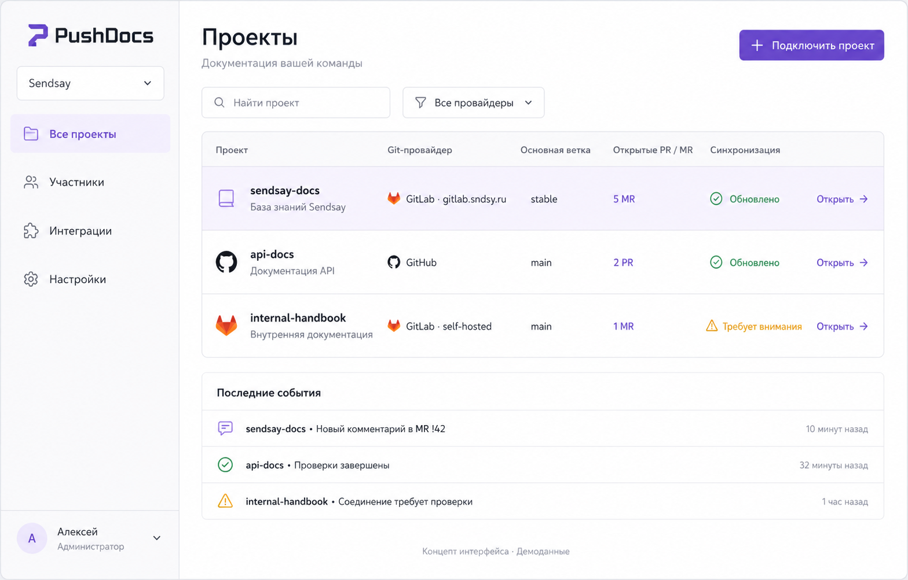
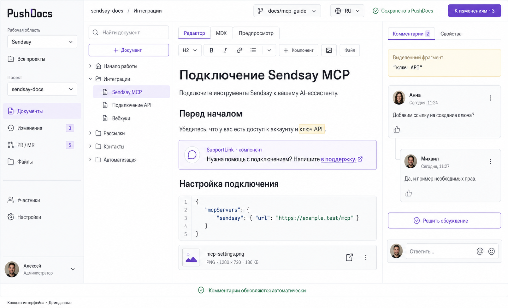
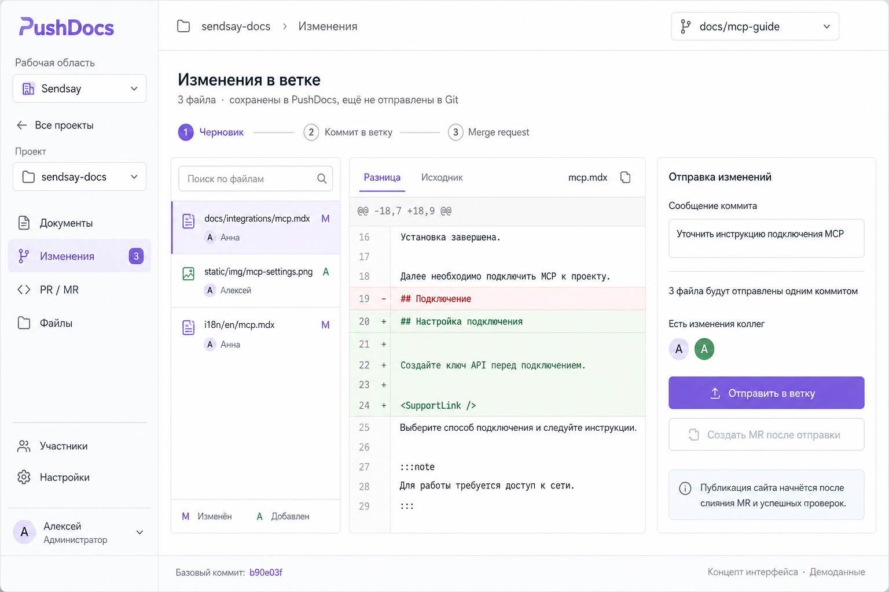
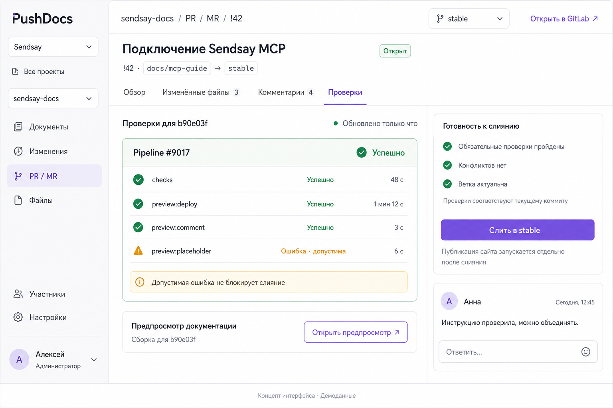
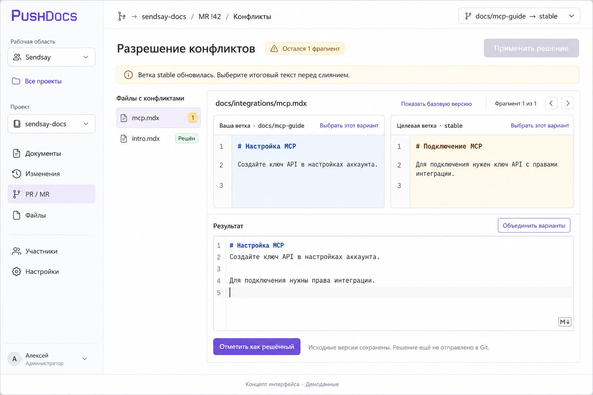
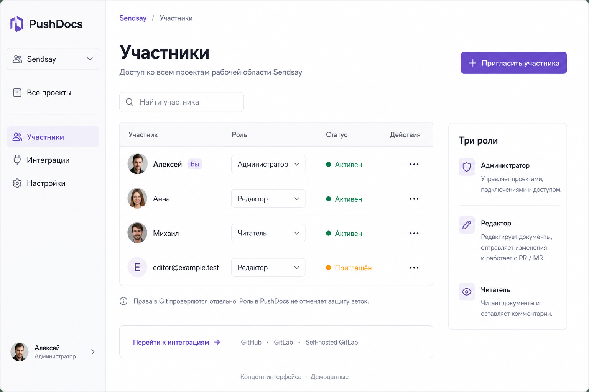

# Интерфейс PushDocs и ранние макеты

В репозитории реализован рабочий MVP. Раздел о вложениях ниже описывает текущий интерфейс. PNG-макеты показывают раннее предлагаемое расположение разделов и элементов и могут отличаться от приложения; оставшиеся предложения отмечены в тексте. Имена пользователей, содержимое документов и состояния проверок приведены для примера, даже если используются знакомые номера MR и pipeline.

Картинки созданы встроенным imagegen. Общий стиль и расположение элементов подготовлены с frontend-design. Точные запросы исходной генерации сохранены в [prompts.json](prompts.json); они описывают прежнюю модель и не являются актуальными требованиями.

После создания картинок согласована структура **«Установка → Проекты → Ветки → Документы»**. Рабочие области исключены. PNG сохранены без изменений как ранние концепты: переключатель Sendsay нужно убрать, а роли и экран пользователей перенести на уровень проекта. Актуальные правила приведены в [ADR](../adr/0001-pushdocs-architecture.md).

## Проекты

Стартовый экран показывает только проекты, к которым у пользователя есть доступ. Каждый проект подключён к репозиторию GitHub или GitLab; несколько сайтов одного репозитория могут быть отдельными проектами. Выбирать ветку до открытия проекта не нужно. Общие пользователи, подключения и системные настройки доступны в отдельном разделе владельца.

## Редактор документа

Слева находятся меню проекта и дерево документов. Сверху видны проект, ветка и язык. Комментарии открываются справа.

### Вложения: текущая реализация

Кнопка «Вставить вложение» открывает все поддерживаемые типы и вставляет Markdown. Выбор DocMedia в меню компонентов открывает галерею изображений и MP4 и вставляет `<DocMedia src="…" alt="…" />`. Папка и база относительного `src` берутся из `media.images`; отдельная привязка компонента в конфиге не нужна. Выбор Video показывает только MP4 и вставляет `<Video src="…" />` с полным публичным URL. При наличии `media.video` используются его папки; иначе — обычная галерея и папка загрузки с фильтром MP4. Подсказки в редакторе используют те же правила путей.

Папки задаются в `.pushdocs/config.json` выбранной ветки: `media.images.directory` для обычных вложений и DocMedia, `media.video.directory` для Video. По умолчанию используется `static/img`. При вставке в статью добавляется относительный путь статьи без расширения. Папку можно изменить в модалке; отсутствующие каталоги создаются при загрузке. При вставке из документа поиск предзаполнен папкой статьи и обновляется при смене папки загрузки. Для просмотра всех блоков поиск можно очистить.

Максимальный размер файла, включая изображение, — 64 МиБ; администратор установки может снизить серверный лимит. На отправку допускается до 256 МиБ вместе с текстовыми файлами, на проект — четыре активные загрузки.

Галерея сама создаёт блоки настроенных локализованных папок. Языки определяются по путям файлов, включая загрузки в черновике. Пустые блоки скрываются; стандартные общие папки и остальные файлы показаны в «Другие файлы проекта». Без настроенных локализованных папок все стандартные файлы `static` попадают туда. Резервные каталоги `static/img` и `static/video` встроены, управлять группами через конфиг не требуется. В карточке выделено имя файла, путь показан менее заметно. Порядок действий: вставить, заменить, скачать, удалить; при выборе DocMedia и Video замена скрыта.

[Пример для sendsay-docs](../examples/sendsay-docs.pushdocs.json) задаёт изображения в `staticLocalized/{locale}/img` и видео в `staticLocalized/{locale}/video`. В публичных URL `/{locale}/img` и `/{locale}/video` сегмент основного языка опускается. `media.documentPathPrefixes.en` удаляет дополнительный `en/` из пути английской статьи. Все поля и значения по умолчанию описаны в [справочнике конфигурации](../configuration.md).

Сохранение в PushDocs не означает отправку в Git. Совместное посимвольное редактирование и общие курсоры не предусмотрены.

## Изменения

Перед отправкой в Git пользователь проверяет список файлов и разницу между версиями. Справа находятся сообщение коммита и действие отправки. Изменения коллег показаны явно.

## PR и MR

Проверки привязаны к конкретному коммиту. Допустимая ошибка показана отдельно от ошибки, которая блокирует слияние. Предпросмотр доступен из того же экрана.

Публикация сайта и слияние MR имеют отдельные статусы. Возможность слияния зависит от роли, прав в Git и правил репозитория. В финальном интерфейсе MR будет фиксированная пара исходной и целевой веток вместо независимого переключателя ветки, который появился на концепте.

## Конфликты

Пользователь сравнивает версии из двух веток и редактирует результат ниже. Базовую версию можно открыть отдельно. Применение недоступно, пока остаются нерешённые фрагменты.

## Пользователи

Экран пользователей должен открываться внутри выбранного проекта. Пользователь имеет отдельную роль в каждом проекте, а удаление из одного проекта не меняет доступ к другим. Читатель может оставлять комментарии. Роль в PushDocs не отменяет ограничения Git-провайдера. Подпись на картинке о доступе ко всем проектам устарела.

## Что ещё нужно уточнить

Логотип, размеры и некоторые иконки различаются между концептами. При разработке их нужно привести к единой системе компонентов Base UI. Лица на картинках сгенерированы и не изображают настоящих пользователей проекта.

На ранних PNG разделы файлов, интеграций и настроек обозначены только в меню и не показаны отдельными экранами. В приложении импорт проекта, выбор ветки и загрузка файлов уже реализованы. Формы свойств компонентов и оставшиеся состояния интерфейса требуют дальнейшей проработки.
